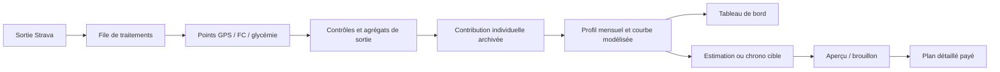

# Audit du parcours coureur — 21 novembre 2026

La structure des données est cohérente : une sortie produit des points détaillés, puis des contributions individuelles et des agrégats mensuels. Elle permet de conserver un profil après suppression des données détaillées. En revanche, **un modèle lissé n’est pas encore une prédiction de chrono validée** et **le nettoyage d’une activité aberrante n’est pas encore complet**.

Audit du code local, tests sur base SQLite en mémoire et contrôle du rendu avec des données fictives. Pas de mesure de précision sur les coureurs réels, pas de migration ni de nettoyage de la base de production, pas de paiement ou d’envoi Strava déclenché.

## Ce qui a été corrigé

- Le plan est réactivé par `PLAN_BUILDER_ENABLED=true` (valeur par défaut). Accès depuis le bouton **Préparer mon plan de course**, puis `?view=plan`. Le tableau de bord et la navigation principale restent en place. Les brouillons sont sauvegardables et réouvrables ; l’import GPX personnel est reconnecté.
- Les deux intentions sont explicites : **Estimer avec mes allures** et **Répartir mon chrono cible**. Le réglage manuel est accessible aussi avec un chrono cible, lorsque le coureur ne dispose pas de références exploitables.
- Le plan affiche le nombre de tranches issues du profil personnel et du collectif. Une référence collective n’est plus présentée comme une mesure du niveau personnel.
- L’initialisation du formulaire attend maintenant ses dépendances JavaScript : auparavant, le script pouvait appeler `PaceCurve` avant le chargement de la bibliothèque différée.
- Un événement de suppression Strava retire désormais les contributions et reconstruit les agrégats même si la sortie détaillée a déjà été purgée. Le traitement répété reste sans effet supplémentaire.
- Une correction de sport ou de mois invalide aussi l’ancien agrégat. Les intervalles contenant des valeurs non finies ou une vitesse de course manifestement invalide sont rejetés.
- Présentation allégée : introduction plus compacte, suppression du bloc redondant « premier plan en 4 étapes », onglets plus courts, couleurs claires. La glycémie du jour dispose d’une carte graphique lorsqu’il existe des observations et une connexion CGM reconnue. Les trous de données restent visibles ; les pourcentages sont calculés sur la durée observée.
- L’endpoint de livraison PDF ne livre plus gratuitement un nouveau plan lorsque la vente est désactivée. Le bouton indique cette indisponibilité. Aucun paramètre Stripe n’a été activé. Attention : avec la vente désactivée, cette protection bloque également une nouvelle livraison d’un ancien achat ; une politique distincte de re-téléchargement reste à définir.

Fichiers principaux : [configuration](../app/settings.py), [routes et tableau de bord](../app/main.py), [traitement et archives](../app/logic.py), [webhooks](../app/routers/webhooks.py), [interface du plan](../templates/user_dashboard.html), [carte glycémie](../templates/_dashboard_glucose.html), [styles](../static/css/plan-flow.css).

## Audit de la séquence



| Étape | Ce qui fonctionne | Limite ou travail restant |
|---|---|---|
| Import Strava | File de traitements pour créations et mises à jour ; activités identifiées par utilisateur et identifiant Strava. | Ne pas considérer tout changement GPS comme automatiquement notifié. Ajouter une commande de réanalyse contrôlée. |
| Enrichissement | Données sportives et CGM rapprochées dans le temps ; description construite à partir des mesures. | Plusieurs erreurs de stockage ou d’agrégation sont capturées puis le traitement continue. Distinguer « importé », « profil calculé », « publié sur Strava » et « incomplet ». |
| Nettoyage | Pauses, ruptures temporelles, vitesses et déplacements verticaux improbables sont filtrés. Les valeurs NaN/inf sont désormais rejetées. | Ces seuils ne détectent pas tout : mauvais sport, FC erronée, altitude décalée ou sortie partiellement motorisée. Ajouter une exclusion réversible du profil, avec motif et quantité de données rejetées. |
| Archivage | Contribution par sortie conservée, agrégats mensuels reconstructibles. La conservation des détails est de 14 jours dans le code. | Après purge, on peut retirer une contribution entière, mais plus recalculer ses points GPS. Versionner le nettoyage et le modèle avant de purger ; conserver les informations suffisantes pour une correction. |
| Tableau de bord | Graphiques existants, statistiques personnelles, mesures CGM facultatives ; pas de nouvelle rubrique ajoutée. | Le tableau de bord charge encore des points détaillés pour des graphiques récents. Utiliser davantage les résumés en cache et réserver les détails à la page de sortie. |
| Plan de course | Même référence modélisée utilisée pour les allures par pente ; répartition par tronçon, pauses et objectif cible. | Pas de validation prédiction/réalité sur un historique indépendant. La précision dépend du terrain et de la représentativité des sorties. |
| Vente et livraison | Brouillons, états d’achat, Stripe, crédits et génération PDF existent. | L’accès payé et le calcul doivent être davantage contrôlés côté serveur avant une ouverture commerciale générale. |

Strava documente les événements de création, suppression et modification de titre/type/visibilité, ainsi qu’un acquittement sous deux secondes. Le traitement asynchrone des créations/mises à jour est donc adapté. La reconstruction d’archives lors d’une suppression reste synchrone : la déplacer aussi dans une file si elle dépasse ce délai. Un passage en privé peut produire un événement de suppression selon les autorisations accordées. [Documentation officielle des webhooks](https://developers.strava.com/docs/webhooks/).

## Fiabilité de la projection

La référence actuelle sélectionne une cellule personnelle suffisamment documentée (300 secondes et 20 points), sinon la médiane d’au moins huit autres coureurs pour la tranche et la zone. Le profil combiné est ajusté par une courbe quadratique asymétrique à un seul minimum : elle arrondit la tendance plutôt que de suivre chaque oscillation observée. C’est cohérent avec la courbe rouge demandée. Voir [sélection des références](../app/pace_reference.py), [modèle](../app/pace_trend.py) et [courbe partagée](../static/js/pace-curve.js).

Le chrono utilise actuellement les distances par **tranches de pente**, avec l’allure modélisée au centre de chaque tranche. Le dessin est continu, mais l’intégration reste discrétisée. Sur une tranche très large, une pente de 31 % et une pente de 39 % utilisent le même repère. Une amélioration pertinente serait d’intégrer la formule sur des segments de pente plus fins, avec exactement le même calcul pour l’écran, la sauvegarde et le PDF.

Pour une allure de référence `p(g)` en secondes/km et des distances `dᵢ` en km :

- Estimation : `T = Σ dᵢ × p(gᵢ) × facteur_parcours + pauses`.
- Chrono cible : `k = (T_cible − pauses) / T_mouvement_de_référence` ; toutes les allures sont multipliées par `k`. La forme de la courbe est conservée.

Le second mode construit des temps de passage compatibles avec l’objectif ; il **ne démontre pas que cet objectif est réalisable**. Une augmentation des pauses impose des allures plus rapides pour conserver le total.

Trois améliorations de fond sont prioritaires :

1. **Revoir l’agrégation des allures.** Les archives pondèrent des allures de sortie par leur durée. Cette moyenne peut différer d’une allure fondée sur distance et temps : 1 km en 5 min puis 1 km en 10 min donne 7 min 30/km au total, contre 8 min 20/km avec cette pondération. Définir l’estimateur voulu, utiliser des distances et durées valides correspondantes, versionner puis reconstruire les données compatibles. Pas de changement silencieux des anciens profils dans ce lot.
2. **Valider chronologiquement.** Pour chaque sortie de validation, construire le profil uniquement avec les sorties antérieures, projeter son parcours puis comparer temps en mouvement et pauses séparément. Mesurer erreur médiane et dispersion selon distance, pente, durée et part de données personnelles. Les fourchettes affichées devront venir de ces erreurs, pas d’un pourcentage arbitraire.
3. **Afficher la qualité utile au coureur.** Période, sorties contributrices, part du parcours couverte par des références personnelles/collectives, date de mise à jour. Distinguer la dispersion entre coureurs d’un intervalle d’incertitude personnel. Les effets de fatigue, technicité, météo et altitude ne sont pas validés par le seul modèle pente/allure.

Le collectif est aujourd’hui lissé avant la construction de la référence combinée, qui peut l’être à nouveau. Une évolution souhaitable est de sélectionner les observations et médianes fiables puis de ne faire qu’un ajustement final. Les courbes de quantiles doivent aussi garder leur ordre.

## Coureur sans historique Strava

| Situation | Comportement à conserver |
|---|---|
| Données personnelles suffisantes | Courbe personnelle dans les zones documentées ; complément collectif explicite. |
| Pas d’historique, collectif suffisant | Courbe médiane comme **repère collectif**. Une estimation ne doit pas être annoncée comme personnalisée. |
| Pas d’historique et collectif insuffisant | Demander des repères manuels, ou une activité importée. Ne pas fabriquer un profil individuel. Le mode manuel est désormais accessible avec un objectif de temps. |
| Chrono cible choisi | Employer la forme de référence disponible et ajuster son échelle. Afficher « objectif réparti », avec pauses comprises. |

À terme, une allure connue sur plat ou un chrono récent peut aider à calibrer le niveau d’un nouveau coureur. Cela ne mesure pas sa technique en descente ni sa résistance sur un ultra. Le niveau de personnalisation doit rester visible.

## Nettoyer réellement une sortie incohérente

La correction des suppressions archivées ferme une faille concrète, mais ne suffit pas à promettre un profil intégralement nettoyable. Il reste à :

- Ajouter « Exclure du profil de performance » et « Restaurer », sans effacer l’activité affichée. Conserver cette décision afin qu’une synchronisation ne réintroduise pas la sortie.
- Invalider contributions, agrégats, courbe personnelle, collectif et caches après une correction.
- Recalculer les records VAM : `delete_activity_live_data` conserve actuellement leurs valeurs en détachant leur `activity_id`. Un mauvais record peut donc survivre au retrait de sa sortie. Conserver aussi l’identifiant Strava d’origine sur le record pour les archives.
- Traiter la modification de FC maximale comme une nouvelle version de classification. Les archives par zone ne permettent pas toujours de reclasser précisément sans les données de FC sous-jacentes.
- Marquer explicitement une archive complète et sa version avant toute purge des détails ; rendre une réanalyse idempotente et observable.

## Design et offre payante proposés

**Accueil :** conserver « Mes sorties / Mon profil », une synthèse personnelle compacte, la glycémie si disponible, puis les activités avec leurs graphiques actuels. Les indicateurs kcal restent des estimations sur les sorties ; pas de nouveau simulateur ni de menu supplémentaire. Pour les écrans détaillés, réduire les paragraphes, garder les explications longues dans une aide dépliable, harmoniser bleu descente / vert roulant / orange montée.

**Plan :** garder trois étapes visibles — parcours, méthode, résultat. Montrer d’abord profil altimétrique, chrono ou objectif, pauses et courbe d’allure utilisée. Mettre les réglages nutritionnels détaillés derrière une action explicite. Un aperçu de quelques passages suffit à expliquer le produit ; le résultat complet ne devrait pas déjà être livré au navigateur derrière un simple masquage.

**Plan payé :** annoncer précisément les éléments inclus : PDF, feuille de route, passages/ravitos, allures par tronçon, pauses, barrières disponibles et version de la référence. Afficher le prix final calculé par le serveur, les conditions de modification et la disponibilité du re-téléchargement. Le code contient plusieurs tarifs et des libellés de prix en dur : les centraliser.

Avant ouverture générale : rendre le calcul serveur faisant autorité, rattacher le droit d’achat à un parcours et à une version autorisée, et contrôler ce lien à chaque livraison. Actuellement `_upsert_course_plan_snapshot` peut modifier le contenu d’un plan acheté tout en conservant son statut. La consommation des crédits et les livraisons doivent aussi résister aux demandes simultanées et aux répétitions de notifications de paiement. Aucun test de paiement réel n’a été effectué ici.

**Enrichissement Strava :** conserver le texte personnel et privilégier 3–4 lignes complémentaires aux statistiques natives. Exemple de structure, à remplir uniquement avec des données présentes :

```text
⛰ Montée : pente moyenne · allure · intensité dominante
↘ Descente : pente moyenne · allure
🔥 Énergie estimée : total · répartition montée / roulant / descente
🟢 Glycémie : temps observé dans la plage · durée de données
```

Éviter une impression de graphique précis à partir de barres emoji et de nombreuses décimales. L’API permet d’enrichir la description textuelle ; les graphiques interactifs détaillés restent sur le site. [Référence officielle Strava](https://developers.strava.com/docs/reference/#api-Activities-updateActivity).

## Vérification et suite proposée

Tests locaux : suite Python de 74 tests réussie ; 9 tests JavaScript sur les courbes, le chrono cible, le mode manuel et l’ordre de chargement réussis. Les nouvelles régressions couvrent notamment suppression après purge, répétition de webhook, conservation des autres coureurs, changement de mois/sport, valeurs non finies, brouillons et absence de livraison quand la vente est fermée. Contrôle visuel sur des données fictives ; syntaxe des scripts issus du rendu vérifiée.

Ordre recommandé : **1. exclusion réversible et records propres ; 2. estimateur/version des archives et validation des chronos ; 3. calcul et droits d’achat côté serveur ; 4. finalisation de l’aperçu payant**. La reconnexion du plan et les allègements d’interface sont réalisés dans le code local ; ce rapport ne constitue pas une validation de précision ni une mise en production commerciale.
